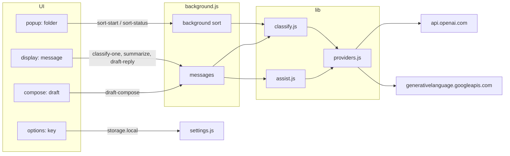
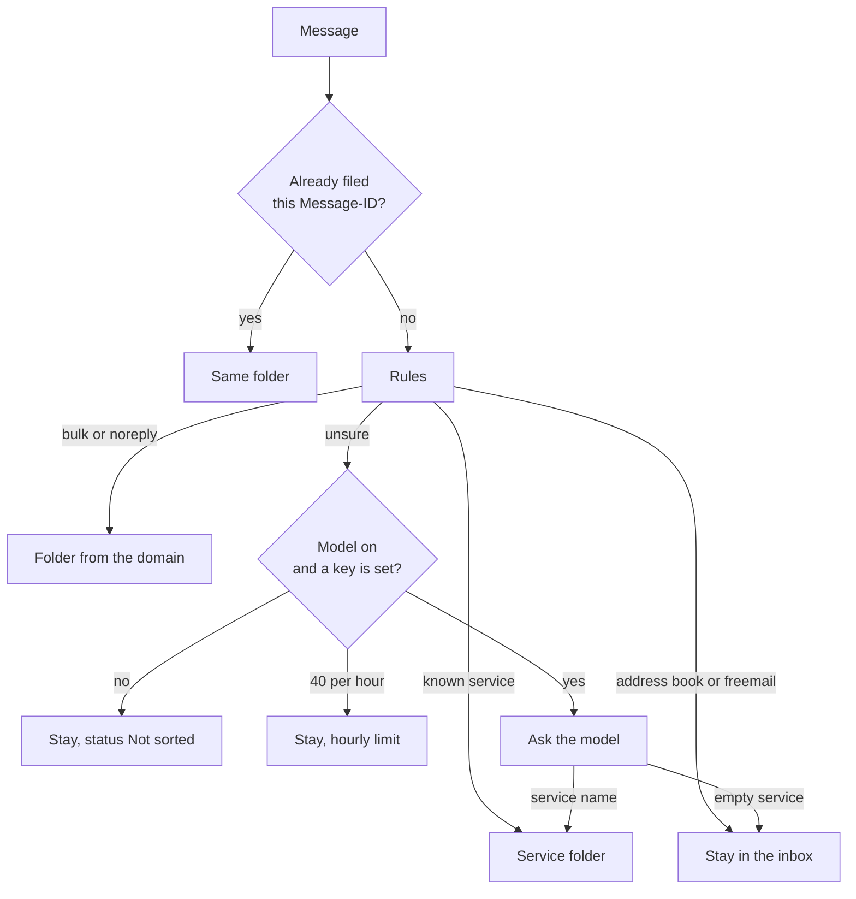

# ai-sorting-and-answering

A Thunderbird 128+ MailExtension (Manifest V3). Mail from a service is filed into a folder of that name under the inbox. Mail from a person stays in the inbox. ChatGPT or Gemini is used when the rules cannot name the sender, and when you ask for a thread summary or a reply draft.

Version in `manifest.json`: 1.0.12. Identifier: `ai-sorting-and-answering@localhost`.

## Install from a file

1. Download [`releases/ai-sorting-and-answering-1.0.12.xpi`](releases/ai-sorting-and-answering-1.0.12.xpi).
2. In Thunderbird, open the menu and choose **Add-ons and Themes**.
3. Click the gear icon and choose **Install Add-on From File…**.
4. Select the downloaded `.xpi` file.
5. When Thunderbird asks for access, choose **Add**.
6. Open the add-on settings and add an API key before using summaries, drafts, or model sorting.

## Install from add-on search

1. In Thunderbird, open the menu and choose **Add-ons and Themes**.
2. In the search field, type `ai-sorting-and-answering` and press Enter.
3. Open the result for this add-on, by Ilya Devin, and choose **Add to Thunderbird**.
4. When Thunderbird asks for access, choose **Add**.

## Layout

```
ai-sorting-and-answering/
├── manifest.json          # permissions, event page, three buttons, options
├── background.js          # sorting, new mail, model calls
├── description.html       # add-on store description
├── ui.css
├── _locales/en/           # interface strings and built-in draft instructions
├── popup/                 # mail toolbar button: sort the open folder
├── display/               # message button: summary, reply, sort again
├── compose/               # compose button: insert a draft
├── options/               # provider, key, model, auto-sort
├── lib/
│   ├── classify.js        # cache, rules, then the model
│   ├── heuristic.js       # rules, no network
│   ├── services.js        # known domains and folder names
│   ├── folders.js         # service folder under the inbox, then move
│   ├── sort-job.js        # background sort progress
│   ├── assist.js          # thread summary and reply draft
│   ├── providers.js       # OpenAI and Gemini, error text
│   ├── settings.js        # key, model, 40 calls an hour
│   ├── explain.js         # error text shown in the UI
│   ├── thread.js          # collect and clip a thread
│   └── text.js            # message text, addresses, draft HTML
├── test/                  # node --test
└── icons/
```

`lib/tags.js` is left from an older tag scheme. The running add-on does not import it. The tests do.

The UI only asks for work. Short actions return an answer immediately. Sorting a folder runs in the background: you can close the menu, and opening it again reads progress through `sort-status`.



## How a message is filed

Local steps run first. The model is called only when those steps are not confident.



Rules in `lib/heuristic.js`:

- A domain listed in `lib/services.js` (LinkedIn, Google, GitHub, and others) becomes the folder name immediately.
- `List-Unsubscribe`, `List-Id`, `Precedence: bulk`, or a `noreply@` address becomes a folder named from the domain, such as Shop.
- An address-book contact and freemail (Gmail, Outlook, and the like) stay in the inbox.
- Anything else is unsure.

The folder is created under the inbox the first time such a message arrives (`lib/folders.js`). The result is remembered by `Message-ID` (up to 400 entries) so the model is not called again.

Where a message comes from:

- New inbox mail, when **Sort new inbox mail** is on.
- **Sort messages**: every message in the open folder, or every selected message when more than one is selected. The background collects the list. The menu shows `Sorted N of M` and the folder counts.
- **Sort again** on an open message files that message once more (`force: true` skips the cache).

## When the model is called

| Action | File | Temperature | 40 per hour |
| --- | --- | --- | --- |
| Uncertain sorting | `lib/classify.js` | 0 | yes |
| Thread summary | `lib/assist.js` | 0.2 | no |
| Reply draft and insert into a message | `lib/assist.js` | 0.4 | no |
| Test the key in settings | `options/options.js` | 0 | no |

One provider is used for every call: ChatGPT or Gemini. An empty model field uses the default from `lib/providers.js`: `gpt-4.1-mini` or `gemini-3.8-flash`. The key stays in this profile’s `storage.local`.

A sort request sends the sender, the recipients, the subject, and the first 1000 letters, numbers, and punctuation marks of the body. HTML is removed first. A summary and a reply draft send the thread: up to 15 messages, each clipped the same way, 12000 characters in total, keeping the newest. **Answer with AI** sends the current draft the same way, after HTML is removed.

A provider error is shown as the `message` text, not as JSON.

## Prompts

The system texts are fixed in code. A user instruction is added only for a draft.

### Sorting

System (`CLASSIFY_SYSTEM`):

```text
Name the company or service that sent this email. Use a short English name such as LinkedIn, Google, or GitHub. If a person wrote the message, use an empty service. Reply with JSON only, in the form {"service":"GitHub"} or {"service":""}.
```

User part:

```text
From: …
To: …
Subject: …

<first 1000 letters, numbers, and punctuation marks, with HTML removed>
```

The answer is parsed as JSON. The `service` field is used, or `name` if that is what came back. An empty name leaves the message in the inbox. A name becomes the folder name.

### Thread summary

System (`SUMMARY_SYSTEM`):

```text
Summarize this email thread for the person reading it. Write in English, including the section headings. Use three short sections: Decisions, Open questions, Next steps. If a section has nothing to report, write None. Do not invent facts.
```

User part, messages of the thread separated by `---`:

```text
From: …
Date: …
Subject: …

text

---

From: …
```

### Draft

System (`REPLY_SYSTEM`), shared by a reply and the compose window:

```text
You draft an email reply for the user. Write the reply in English. Return only the reply text. Do not include a subject line. Do not quote the original message. The program places your text above the existing draft, so do not repeat text that is already there.
```

Reply to the open message. An empty instruction uses “Write a helpful reply to the latest message.”

```text
Instruction: …
Thread:
From: …
```

Compose window, **Answer with AI**. **Style** is remembered and applies to both buttons. **Answer** starts with “Write a reply to this message.” **Decline** starts with “Decline this request.” The selected style is added after that: Polite, Funny, Sad, Tricky, Angry, Philosophic, Buddha, Formal, Warm, Brief, or Dry.

```text
Instruction: …

Current draft:
<first 1000 letters, numbers, and punctuation marks, with HTML removed>
```

The finished text is inserted above whatever is already in the message.

### Key test

```text
System: Reply with the single word ok.
User: ping
```

Any answer without an error is enough. The answer text is not shown in the UI.
